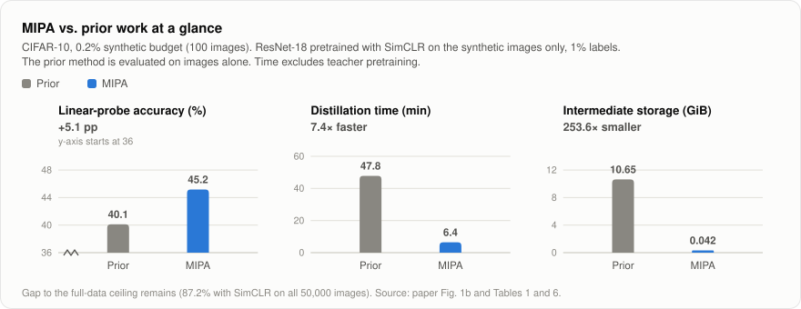
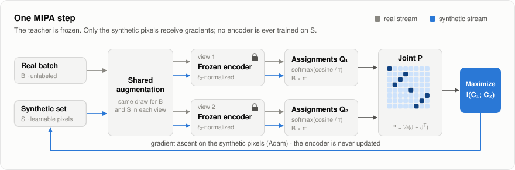
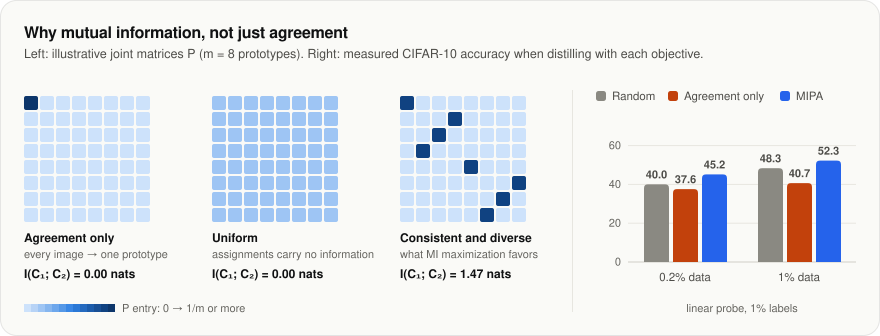
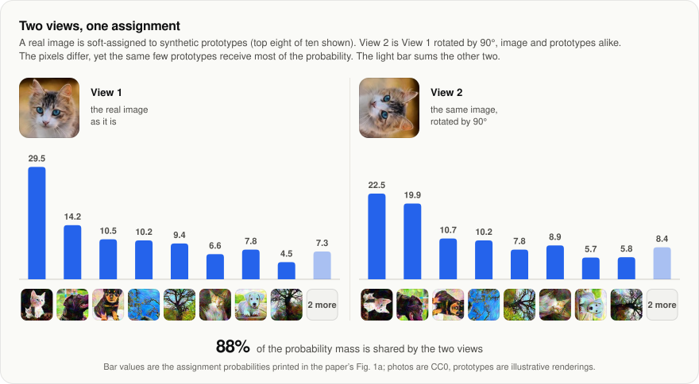
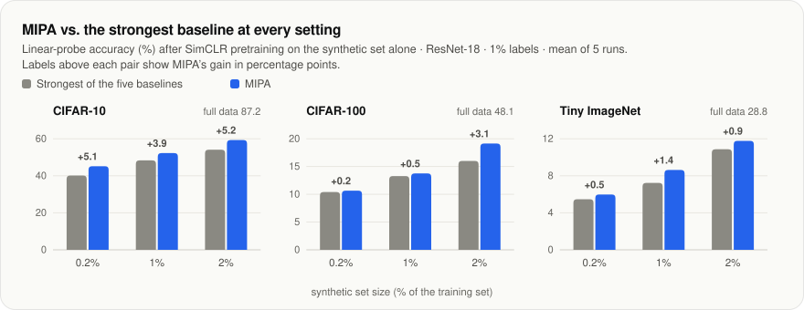
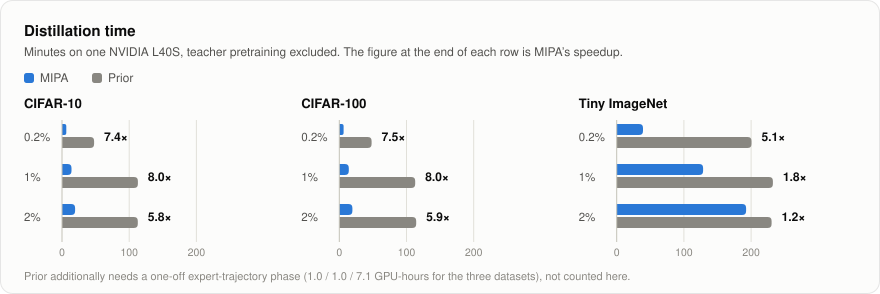
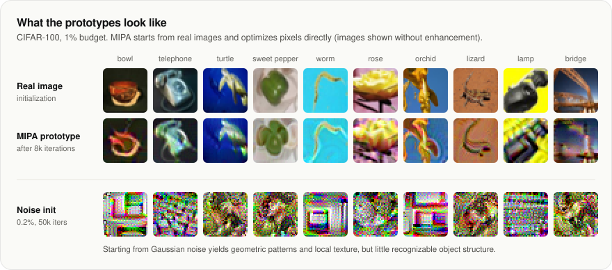
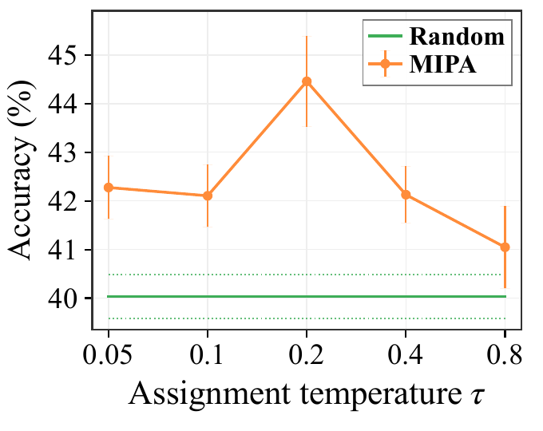
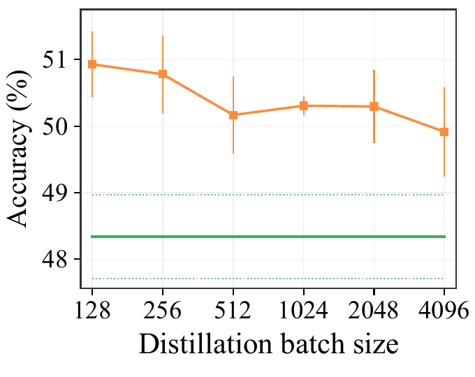

<div align="center">



<br>


[](LICENSE)
[](#citation)

**Compress an unlabeled dataset into a tiny synthetic set (0.2-2% of its size) that self-supervised learning can pretrain on from scratch.**<br>
No class labels. No auxiliary teacher targets. No inner-loop training.

[Overview](#overview) &nbsp;·&nbsp; [How it works](#how-it-works) &nbsp;·&nbsp; [Results](#results) &nbsp;·&nbsp; [Quick start](#quick-start) &nbsp;·&nbsp; [Reproducing the paper](#reproducing-the-paper) &nbsp;·&nbsp; [Citation](#citation)

<sub>Mohammad Hossein Moslemi · Mahdi Beitollahi · Zhimin Mei · Jiale Cai · Bissan Ghaddar · Boyu Wang<br>
Western University · Queen's University · Ivey Business School · Vector Institute</sub>

</div>

<br>

<p align="center">
  
</p>

<sub><i>Prior</i> is the previous best self-supervised distillation method (MKDT), evaluated on images alone. Time is measured on one NVIDIA L40S and excludes teacher pretraining (needed by both methods) and Prior's expert-trajectory generation. Storage is intermediate distillation data, which for Prior means expert-trajectory buffers (paper Fig. 1b, Tables 1 and 6).</sub>

---

## Overview

Dataset distillation (DD) compresses a large dataset into a tiny synthetic one that still trains a good model. Almost all of it assumes class labels. **MIPA** targets the label-free case: distill an *unlabeled* dataset so that a standard self-supervised learner, trained from scratch on the synthetic images alone, ends up with useful representations.

Existing self-supervised DD methods adapt supervised DD by shipping auxiliary target representations alongside the images. In the paper's experiments, strip those targets away and the images alone do not reliably beat a random subset of real data. MIPA instead optimizes the images for what SSL actually needs: **information that survives augmentation**.

| | Prior methods | **MIPA** |
|---|---|---|
| Pretraining needs auxiliary target representations | yes | **no**, images only |
| Pretraining objective | target-matching losses | **standard SSL** (SimCLR, Barlow Twins) |
| Extra state during distillation | expert-trajectory buffers (10.7 GiB on CIFAR-10) | **0.04 GiB**; only a frozen teacher |

## How it works

Treat every synthetic image as a **learnable prototype** in the feature space of a frozen, pre-trained encoder. Each real image is softly assigned to the prototypes by cosine similarity. If the synthetic set preserves augmentation-invariant information, two augmented views of the same real image should receive *consistent* assignments. MIPA maximizes the **mutual information** between the two views' assignments, and the gradient flows into the synthetic pixels.

<p align="center">
  
</p>

For an augmentation $a$ and a frozen teacher $f_{\theta_{\mathcal T}}$, a real image $x$ is assigned to the $m$ synthetic prototypes $x^s_j$ by

$$
q(j \mid x, \mathcal S, a) = \frac{\exp\left(\psi_a(x)^{\top}\psi_a(x^s_j)/\tau\right)}{\sum_{r=1}^{m}\exp\left(\psi_a(x)^{\top}\psi_a(x^s_r)/\tau\right)},
\qquad
\psi_a(x) = \frac{f_{\theta_{\mathcal T}}(a(x))}{\lVert f_{\theta_{\mathcal T}}(a(x))\rVert_2}.
$$

For a batch of $B$ real images and two independently drawn augmentations (each applied identically to the real *and* synthetic images in its view), stack the assignments into $Q_1, Q_2 \in \mathbb{R}^{B\times m}$ and form the symmetric joint distribution

$$
J = \tfrac{1}{B}\,Q_1^{\top} Q_2, \qquad P = \tfrac{1}{2}\left(J + J^{\top}\right), \qquad
I_P(C_1;C_2) = \sum_{j,r} P_{jr}\log\frac{P_{jr}}{p_j\,p_r},
$$

and the synthetic set is the maximizer of the expected mutual information:

$$
\mathcal S^{*} \in \arg\max_{\mathcal S}\ \mathbb{E}_{\mathcal B,\,a^{(1)},\,a^{(2)}}\left[ I_P(C_1;C_2) \right].
$$

Since $I_P = H_P(C_1) - H_P(C_1\mid C_2)$, one objective does two jobs: a low conditional entropy makes each view's assignment **predictable from the other** (augmentation consistency), and a high marginal entropy forces **many prototypes to be used** (diversity).

### Why not just enforce agreement?

Minimizing the distance between the two views' assignments is the obvious alternative, and it has a trivial optimum: assign every image to the same prototype and the loss is zero while all information is gone. Mutual information is zero there too, so it cannot be gamed this way.

<p align="center">
  
</p>

Measured on CIFAR-10 (1% labels), distilling with the agreement objective alone lands **below a random subset** (37.6 vs. 40.0 at 0.2%; 40.7 vs. 48.3 at 1%), while the mutual-information objective lands well above it.

The loss lives in `bipartite_view_transition_loss` in [`distill.py`](distill.py). It is implemented as joint entropy minus $\beta$ times the row and column marginal entropies, which for the default `--beta 1` is exactly $-I_P(C_1;C_2)$.

What consistency looks like in practice: one real image and the same image rotated by 90°, assigned to ten prototypes. Even though the encoder sees different pixels in each view, the two assignment distributions overlap by 88%. The bar values are the assignment probabilities printed in the paper's Fig. 1a; the photos are CC0 (see [`assets/IMAGE_CREDITS.md`](assets/IMAGE_CREDITS.md)) and the synthetic prototypes are illustrative renderings of them, not outputs of a run.

<p align="center">
  
</p>

## Results

All numbers are linear-probe accuracy (%) of a **ResNet-18 pretrained from scratch with SimCLR on the synthetic images only**, then evaluated with a linear classifier on 1% or 5% of the labels. Values are means over five runs; standard deviations are in the paper. `Random`, `K-Means` and `SAS` select real images; `KRR-ST` and `Prior (MKDT)` distill images and are evaluated image-only. `Full data` pretrains on the whole training set and is the ceiling.

<p align="center">
  
</p>

### Accuracy with 1% labels

| Dataset | Budget | Random | K-Means | SAS | KRR-ST | Prior (MKDT) | **MIPA** | Full data |
|---|---:|---:|---:|---:|---:|---:|---:|---:|
| **CIFAR-10** | 0.2% | 40.04 | 38.77 | 37.91 | 28.22 | 40.12 | **45.18** | |
| | 1% | 48.34 | 46.10 | 44.56 | 29.07 | 40.29 | **52.26** | 87.23 |
| | 2% | 54.10 | 52.98 | 49.87 | 41.26 | 40.56 | **59.31** | |
| **CIFAR-100** | 0.2% | 9.91 | 8.51 | 10.41 | 8.28 | 9.43 | **10.65** | |
| | 1% | 12.45 | 11.79 | 13.29 | 9.62 | 10.72 | **13.76** | 48.12 |
| | 2% | 14.42 | 15.00 | 16.01 | 14.11 | 7.53 | **19.15** | |
| **Tiny ImageNet** | 0.2% | 5.46 | 5.00 | 5.42 | 5.47 | 5.33 | **5.98** | |
| | 1% | 7.18 | 6.62 | 7.23 | 6.45 | 5.76 | **8.63** | 28.78 |
| | 2% | 10.87 | 10.37 | 10.85 | 9.85 | 5.73 | **11.77** | |

<details>
<summary><b>Accuracy with 5% labels</b></summary>

| Dataset | Budget | Random | K-Means | SAS | KRR-ST | Prior (MKDT) | **MIPA** | Full data |
|---|---:|---:|---:|---:|---:|---:|---:|---:|
| **CIFAR-10** | 0.2% | 46.20 | 45.19 | 44.39 | 34.23 | 46.76 | **50.58** | |
| | 1% | 52.05 | 51.80 | 52.17 | 35.93 | 46.66 | **57.36** | 89.03 |
| | 2% | 58.24 | 57.77 | 55.49 | 47.27 | 46.55 | **62.53** | |
| **CIFAR-100** | 0.2% | 16.87 | 15.25 | 17.12 | 14.75 | 16.11 | **17.17** | |
| | 1% | 20.50 | 19.50 | 20.39 | 16.89 | 18.20 | **21.70** | 57.01 |
| | 2% | 23.15 | 24.07 | 24.68 | 22.17 | 14.14 | **27.58** | |
| **Tiny ImageNet** | 0.2% | 9.88 | 9.23 | 9.54 | 10.30 | 10.14 | **10.49** | |
| | 1% | 13.90 | 13.49 | 13.42 | 12.78 | 11.20 | **15.11** | 39.81 |
| | 2% | 18.21 | 17.91 | 18.08 | 16.97 | 11.63 | **19.10** | |

</details>

**Reading the numbers honestly.** MIPA has the highest mean in every configuration, and the margin is clear on CIFAR-10 (+3.9 to +5.2 points over the strongest baseline) and at the 2% CIFAR-100 budget (+3.1). On CIFAR-100 at the 0.2% and 1% budgets the gain is under half a point, about the size of the run-to-run standard deviation; on Tiny ImageNet it is between 0.5 and 1.4 points. A gap to full-data pretraining remains everywhere. MIPA also keeps improving as the synthetic set grows, whereas the image-only prior method barely improves or even drops.

### Cheaper to distill

<p align="center">
  
</p>

MIPA is 5.8-8.0× faster than the prior method on CIFAR-10 and CIFAR-100, before even counting its expert-trajectory generation. On Tiny ImageNet the advantage is large at 0.2% (5.1×) and shrinks at larger budgets (1.2× at 2%). Intermediate storage drops from 10.65-11.91 GiB of trajectory buffers to 0.042 GiB, **over 250× less on all three datasets**.

<details>
<summary><b>Table: distillation cost</b></summary>

| Dataset | Method | 0.2% (min) | 1% (min) | 2% (min) | Expert trajectories (GPU-h) | Storage (GiB) |
|---|---|---:|---:|---:|---:|---:|
| CIFAR-10 | Prior | 47.82 | 112.90 | 112.83 | 1.01 | 10.65 |
| | **MIPA** | **6.43** | **14.07** | **19.48** | none | **0.042** |
| CIFAR-100 | Prior | 47.98 | 112.95 | 114.40 | 0.98 | 10.65 |
| | **MIPA** | **6.38** | **14.12** | **19.50** | none | **0.042** |
| Tiny ImageNet | Prior | 200.62 | 232.43 | 230.62 | 7.13 | 11.91 |
| | **MIPA** | **39.15** | **128.58** | **192.68** | none | **0.042** |

Single NVIDIA L40S; teacher pretraining excluded (required by MIPA and prior methods alike). Storage is intermediate distillation data.

</details>

### What the prototypes look like

<p align="center">
  
</p>

Starting from real images, MIPA keeps the object layout and changes color, contrast and texture; some prototypes gain sharper boundaries, others pick up visible distortions. Starting from Gaussian noise is much worse (see *Initialization* below): geometric patterns appear, object structure does not.

### Beyond the default setting

<details>
<summary><b>Other architectures:</b> distilled with ResNet-18, pretrained as ResNet-34 / ResNet-50</summary>

CIFAR-10 pretraining, linear probe with 1% labels, accuracy (%) on CIFAR-10 / CIFAR-100 / Tiny ImageNet.

| Network | Budget | Method | CIFAR-10 | CIFAR-100 | Tiny ImageNet |
|---|---:|---|---:|---:|---:|
| ResNet-34 | 0.2% | Random | 39.39 | 9.27 | 3.99 |
| | | **MIPA** | **43.15** | **9.84** | **4.43** |
| | 1% | Random | 47.20 | **11.39** | 4.71 |
| | | **MIPA** | **51.61** | 10.86 | **4.91** |
| ResNet-50 | 0.2% | Random | 37.48 | 8.43 | 3.95 |
| | | **MIPA** | **41.09** | **9.72** | **4.70** |
| | 1% | Random | 46.09 | 11.78 | 5.13 |
| | | **MIPA** | **49.85** | **12.13** | **5.42** |

MIPA beats Random on the source dataset in every evaluated setting, and on downstream tasks in almost all of them. See the paper (Table 2) for CIFAR-100 pretraining and 5% labels.

</details>

<details>
<summary><b>Other SSL methods:</b> teacher trained with SimCLR, student pretrained with Barlow Twins</summary>

Linear probe on the source dataset, 1% labels.

| Source | Budget | Random | Prior | **MIPA** |
|---|---:|---:|---:|---:|
| CIFAR-10 | 0.2% | 39.92 | 36.38 | **40.07** |
| | 1% | 49.34 | 43.32 | **50.65** |
| CIFAR-100 | 0.2% | 10.03 | 10.18 | **12.00** |
| | 1% | 15.09 | 12.03 | **17.05** |

Images distilled against a SimCLR teacher transfer to Barlow Twins pretraining. The CIFAR-10 margin over Random at 0.2% is within noise (Random has ±1.6). See the paper (Table 4) for all downstream targets.

</details>

<details>
<summary><b>Initialization:</b> real images vs. clustering vs. noise</summary>

CIFAR-10, linear probe with 1% labels.

| Initialization | 0.2% budget | 1% budget |
|---|---:|---:|
| **Random real images** (default) | **45.18** | **52.26** |
| K-Means | 43.72 | 50.73 |
| IIC | 43.32 | 50.15 |
| Gaussian noise | 39.18 | 38.13 |
| Gaussian noise, 3× iterations | 41.98 | 42.82 |
| Gaussian noise, 10× iterations | 42.62 | 43.13 |

Real images give the optimizer structure that is hard to recover from noise, even with ten times the iterations.

</details>

<details>
<summary><b>Sensitivity:</b> assignment temperature and distillation batch size</summary>

<p align="center">
  
  
</p>

MIPA beats Random across the whole sweep. An intermediate temperature (τ = 0.2, the default) works best: smaller values make assignments too sharp, larger ones too uniform. Larger distillation batches do not help; averaging the joint matrix over a big batch smooths the marginal distribution and weakens the diversity signal.

</details>

<details>
<summary><b>Cross-dataset transfer</b></summary>

Encoders pretrained on MIPA's CIFAR-10, CIFAR-100 or Tiny ImageNet synthetic sets were linear-probed on the other two datasets plus FGVC Aircraft and Stanford Dogs. MIPA matches or outperforms the other evaluated methods in every transfer setting among CIFAR-10, CIFAR-100 and Tiny ImageNet. On Aircraft and Dogs the picture is less stable and the prior method or Random win some settings. Per-pair plots are in the paper (Fig. 3).

</details>

---

## Quick start

### Install

```bash
git clone https://github.com/mhmoslemi/MIPA.git
cd MIPA
pip install -r requirements.txt
```

Requires **Python 3.10+** and **PyTorch ≥ 2.1**. A CUDA GPU is strongly recommended (the paper's timings are from one NVIDIA L40S); everything also runs on CPU, just slowly. Runs use POSIX file locks, so use Linux or macOS (WSL on Windows).

### Prepare data

Point `--data-path` at a folder (default `data/`) laid out like this. Only official train/test splits are used, and nothing is downloaded automatically.

| Dataset | Expected under `data/` |
|---|---|
| CIFAR-10 | `cifar-10-batches-py/` (the extracted Python archive) |
| CIFAR-100 | `cifar-100-python/` |
| Tiny ImageNet | `tinyimagenet.pt`, a dict with `images_train`, `images_val` (RGB `uint8`, NCHW, 3×64×64) and `labels_train`, `labels_val` |
| FGVC Aircraft | `fgvc-aircraft-2013b/data/` (or `aircraft/fgvc-aircraft-2013b/data/`) |
| Stanford Dogs | `StanfordDogs/` with `train_list.mat`, `test_list.mat` and `images/` (also found as `dogs/` or `stanford_dogs/`) |

Aircraft and Dogs are only needed as transfer targets.

### Run the three stages

Run from the repository root.

```bash
# 1. Train the frozen SimCLR ResNet-18 teacher on the full unlabeled training set
python train_teacher.py --dataset CIFAR10

# 2. Distill: optimize a synthetic set holding 0.2% of the training set
python distill.py --dataset CIFAR10 --percentage 0.2

# 3. Pretrain a fresh encoder on the synthetic images only, then linear-probe it
python eval.py --synthetic-checkpoint runs/CIFAR10/0.2/synthetic.pt --targets source
```

`--targets all` evaluates on the source dataset plus every transfer target from the paper and needs all five datasets on disk. Compare against the no-distillation baseline with a random real subset of the same size:

```bash
python eval.py --random-subset --dataset CIFAR10 --percentage 0.2 --targets source
```

Distillation checkpoints every 500 iterations. If a run is interrupted, re-run the same command with `--resume`.

> [!TIP]
> Prefer module-style invocation? Keep the folder named `MIPA` and run `python -m MIPA.train_teacher ...` from its parent directory; every script supports both forms.

### What you get

```text
runs/CIFAR10/
├── teacher/
│   └── encoder.pt                  # frozen SimCLR ResNet-18 teacher
└── 0.2/
    ├── synthetic.pt                # distilled images + metadata + resumable state
    ├── prototypes_1.png            # prototypes after the first step (≈ the real-image initialization)
    ├── prototypes_10000.png        # the final prototypes
    └── eval_simclr_ResNet18_seed0/
        ├── encoder.pt              # encoder pretrained on the synthetic set
        ├── probes/                 # one JSON per target, label budget and probe seed
        └── summary.json            # mean ± std accuracy per target and label budget
```

### Use the distilled images

`synthetic.pt` stores normalized pixels in `data` along with the `normalization` used. To get ordinary `[0, 1]` images:

```python
import torch

ckpt = torch.load("runs/CIFAR10/0.2/synthetic.pt", map_location="cpu", weights_only=True)
mean, std = (torch.tensor(v).view(1, 3, 1, 1) for v in ckpt["normalization"])
images = (ckpt["data"] * std + mean).clamp(0, 1)   # (m, 3, H, W), ready for any SSL pipeline
```

## Reproducing the paper

Defaults reproduce the paper's setup, so the three commands above are all you need per dataset and budget.

| Setting | Value |
|---|---|
| Datasets | CIFAR-10, CIFAR-100 (50k train images), Tiny ImageNet (100k, 64×64) |
| Synthetic budgets | 0.2%, 1%, 2% of the training set: 100 / 500 / 1,000 images (CIFAR), 200 / 1,000 / 2,000 (Tiny ImageNet) |
| Teacher | ResNet-18 (BatchNorm), SimCLR, 1,000 epochs, batch 256; seed 0 for CIFAR, 1 for Tiny ImageNet |
| Distillation | Adam, real-batch size 128, assignment temperature τ = 0.2, **10k / 8k / 6k** iterations for the 0.2% / 1% / 2% budgets, real-image initialization |
| Student pretraining | SimCLR, 2,000 epochs, batch 256, LARS (Barlow Twins: 10,000 epochs) |
| Linear probe | frozen encoder, 100 epochs, class-balanced 1% and 5% label subsets, 5 probe seeds, accuracy read once at the final epoch |

<details>
<summary><b>Command-line reference</b></summary>

**`train_teacher.py`**

| Flag | Default | Meaning |
|---|---|---|
| `--dataset` | required | `CIFAR10`, `CIFAR100` or `TinyImageNet` |
| `--epochs` | `1000` | SimCLR epochs |
| `--batch-size` | `256` | |
| `--seed` | paper seed | `0` for CIFAR, `1` for Tiny ImageNet |
| `--output` | `runs/<dataset>/teacher` | |

**`distill.py`**

| Flag | Default | Meaning |
|---|---|---|
| `--dataset` | required | |
| `--percentage` | `0.2` | synthetic set size, % of the training split |
| `--iterations` | `10000` / `8000` / `6000` for 0.2 / 1 / 2 (else `10000`) | optimization steps |
| `--lr-img` | `0.0015` (`0.001` for Tiny ImageNet at 2%) | Adam learning rate on pixels |
| `--batch-size` | `128` | real images per step |
| `--temperature` | `0.2` | assignment temperature τ |
| `--beta` | `1.0` | weight on the marginal entropies; `1.0` is exactly mutual information |
| `--augmentation` | `color_crop_cutout_scale` | differentiable augmentation applied to real and synthetic images |
| `--prototype-pool-size` | `0` | split prototypes into balanced pools (0 = one pool) |
| `--teacher` | `runs/<dataset>/teacher/encoder.pt` | frozen teacher checkpoint |
| `--output` | `runs/<dataset>/<percentage>` | |
| `--seed`, `--device`, `--feature-batch`, `--save-every`, `--resume` | `0`, auto, `128`, `500`, off | |

**`eval.py`**

| Flag | Default | Meaning |
|---|---|---|
| `--synthetic-checkpoint` or `--random-subset` | one required | what to pretrain on |
| `--targets` | `source` | `source`, `all`, or any of `CIFAR10 CIFAR100 TinyImageNet Aircraft Dogs` |
| `--labels` | `1 5` | label budgets (%) for the linear probe |
| `--model` | `ResNet18` | `ResNet18`, `ResNet34`, `ResNet50`, `ConvNet`, `VGG11` |
| `--ssl-method` | `simclr` | `simclr` or `barlowtwins` |
| `--ssl-epochs` | `2000` (SimCLR) / `10000` (Barlow Twins) | |
| `--probe-epochs` | `100` | |
| `--probe-seeds` | `0 1 2 3 4` | |
| `--batch-size`, `--seed`, `--workers`, `--device`, `--output` | `256`, `0`, `0`, auto, next to the checkpoint | |

</details>

<details>
<summary><b>Implementation notes</b></summary>

- **Shared augmentations.** In each view, real and synthetic images get the same differentiable augmentation draw (one seed per view), so they are compared under matched transformations and gradients reach the synthetic pixels through the augmentation. Real images are encoded under `no_grad`.
- **Reference-implementation details.** Beyond the loss above, `distill.py` cosine-anneals the learning rate to 1% of its initial value, smooths pixel gradients with a 3×3 Gaussian kernel before each Adam step, clamps pixels to the valid image range after each step, and scales the temperature by `log(100) / log(max(m, 100))` so that sets larger than 100 prototypes use a proportionally sharper effective τ (identical to `--temperature` for m ≤ 100).
- **Reproducibility guards.** Teacher and encoder checkpoints carry SHA-256 hashes of their weights and of the source data. A run refuses to resume against a different teacher, dataset or recipe, writes files atomically, and takes an exclusive lock on its output folder. The linear probe verifies that the encoder (including BatchNorm buffers) is bit-identical before and after probing, and reports accuracy at the prespecified final epoch, never the best test epoch.
- **Baselines.** The repo ships the random-subset baseline (`--random-subset`). KRR-ST and MKDT sets in the paper were generated with their official implementations and then evaluated with this same SSL protocol (images only); K-Means and SAS are real-image selection baselines.

</details>

## Repository map

| File | Role |
|---|---|
| [`train_teacher.py`](train_teacher.py) | Pretrains the frozen SimCLR teacher on the full training split |
| [`distill.py`](distill.py) | **MIPA**: the cross-view mutual-information loss and the synthetic-image optimizer |
| [`eval.py`](eval.py) | Pretrains a fresh encoder on synthetic (or random) images, then runs the multi-seed linear probes |
| [`ssl_training.py`](ssl_training.py) | SimCLR and Barlow Twins training with LARS, checkpointing and resume |
| [`data.py`](data.py) | Dataset readers, SSL augmentations, class-balanced label subsets |
| [`dd_teachers.py`](dd_teachers.py) | Loads the teacher and bridges teacher / synthetic-image normalization |
| [`dm_dsa.py`](dm_dsa.py), [`utils.py`](utils.py) | Differentiable (siamese) augmentation used during distillation |
| [`common.py`](common.py) | Hashing, atomic writes, run locks, encoder construction and loading |
| [`benchmark_networks.py`](benchmark_networks.py), [`networks.py`](networks.py), [`resnet.py`](resnet.py) | Backbones: ResNet-18/34/50, ConvNet, VGG-11 |

## Citation

If MIPA is useful in your work, please cite the paper (GitHub's **Cite this repository** button reads [`CITATION.cff`](CITATION.cff)):

```bibtex
@article{moslemi2026mipa,
  title   = {Self-Supervised Dataset Distillation via Mutual Information Maximization},
  author  = {Moslemi, Mohammad Hossein and Beitollahi, Mahdi and Mei, Zhimin and
             Cai, Jiale and Ghaddar, Bissan and Wang, Boyu},
  journal = {arXiv preprint},
  year    = {2026}
}
```

## Acknowledgements

MIPA builds on public work from the dataset-distillation and self-supervised-learning communities. The differentiable siamese augmentation in `utils.py` and the CIFAR-style backbones follow the dataset-condensation code of Zhao and Bilen (DC / DSA), SimCLR and Barlow Twins provide the pretraining objectives, and the information-maximization view of cluster assignments follows Invariant Information Clustering (Ji et al.). The photographs in the figures are CC0 and credited in [`assets/IMAGE_CREDITS.md`](assets/IMAGE_CREDITS.md).

## License

Released under the [MIT License](LICENSE). Code adapted from third-party projects remains under its original license.

<div align="center">
<sub>Questions or bugs? Open an issue.</sub>
</div>
